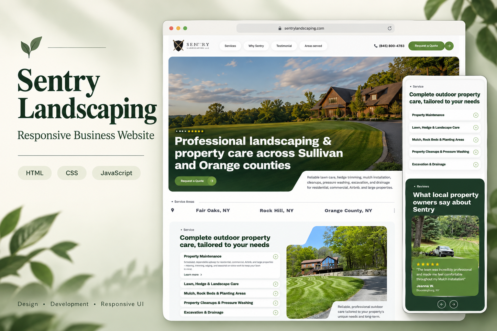

# Sentry Landscaping — Business Website



A responsive, multi-page website for Sentry Landscaping LLC, presenting landscaping and property maintenance services across Sullivan and Orange counties in New York. Built with HTML, CSS, and vanilla JavaScript, the site brings service information, customer testimonials, service-area discovery, and a quote request interface into one consistent experience.

[View the full homepage screenshot](assets/readme/homepage-preview.png)

## Highlights

- **Responsive layouts:** Dedicated desktop and mobile styling, with a collapsible mobile navigation menu.
- **Service discovery:** Expandable service sections covering lawn maintenance, hedge and bush trimming, weed management, planting and bed care, Airbnb property maintenance, and large property care.
- **Interactive carousels:** Swiper-powered company highlight and testimonial sliders, including synchronized featured review content.
- **Service-area map:** Leaflet and OpenStreetMap integration with selectable locations, custom markers, popups, and animated map navigation.
- **FAQ accordion:** Expandable answers with animated transitions and `aria-expanded` state updates.
- **Quote request interface:** A dedicated page for collecting prospective customer details and property care needs.
- **Custom visual styling:** Image masks, branded assets, SVG icons, and a continuously animated location strip.

## Pages

| Page | File | Purpose |
| --- | --- | --- |
| Home | [index.html](index.html) | Business overview, services, reviews, service areas, and FAQs |
| Services | [pages/service.html](pages/service.html) | Landscaping and property maintenance offerings |
| Why Sentry | [pages/why_sentry.html](pages/why_sentry.html) | Company approach, commitments, and customer trust |
| Location | [pages/location.html](pages/location.html) | Bloomingburg-focused service information and nearby coverage |
| Request a Quote | [pages/quate.html](pages/quate.html) | Customer inquiry form and contact information |

## Tech Stack

| Technology | Use |
| --- | --- |
| HTML5 | Page structure and content |
| CSS3 | Layouts, responsive breakpoints, transitions, and image effects |
| Vanilla JavaScript | Navigation, accordions, animations, and component behavior |
| Swiper 11 | Touch-friendly carousels |
| Leaflet 1.9.4 | Interactive service-area maps |
| OpenStreetMap | Map tiles |

Swiper and Leaflet load through CDNs. No package installation or build step is required.

## Run Locally

Clone the repository:

```bash
git clone https://github.com/developer-rafsan/evans-client-project.git
cd evans-client-project
```

Start a local static server from the project root. If Python 3 is installed:

```bash
python3 -m http.server 8000
```

Open **http://localhost:8000** in your browser. You can also serve the project using the VS Code Live Server extension.

An internet connection is needed for CDN libraries and map tiles.

## Project Structure

```text
.
├── index.html              # Homepage
├── pages/
│   ├── service.html        # Services page
│   ├── why_sentry.html     # Company information
│   ├── location.html       # Location page
│   └── quate.html          # Quote request page
├── css/
│   ├── style.css           # Global styles
│   ├── header.css          # Navigation styles
│   ├── footer.css          # Footer styles
│   ├── home.css            # Homepage styles
│   ├── service.css
│   ├── why_sentry.css
│   ├── location.css
│   └── quate.css
├── js/
│   └── main.js             # Shared interactions and map setup
└── assets/                 # Images, logos, masks, and icons
```

## Implementation Notes

This is a static frontend implementation. The quote form currently uses `action="#"` and has no backend or email delivery integration. Reviews and business content are defined in the HTML; they are not fetched from a live reviews API. Social links currently point to platform homepages.

To adapt the website, edit page content in the HTML files, update the matching CSS files, and adjust service-area coordinates in `js/main.js`.

## Deployment

The project can be hosted on any static hosting service. Publish the project root so that `index.html`, `pages/`, `css/`, `js/`, and `assets/` retain their relative paths. No build command is needed.

## Portfolio Summary

> Developed a responsive, five-page landscaping business website using HTML, CSS, and vanilla JavaScript. Implemented mobile navigation, animated accordions, Swiper testimonial carousels, and a Leaflet service-area map with synchronized location selection. Organized shared interactions and page-specific styles to support a consistent experience across desktop and mobile screens.

## Developer

[Rafsan — GitHub](https://github.com/developer-rafsan)
